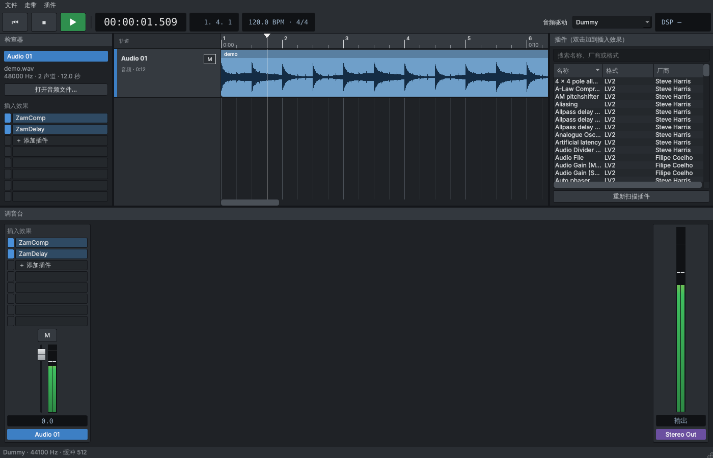

# chost：基于 Carla 的独立音频插件宿主

`chost` 是一个直接链接 libcarla 的独立插件宿主，有图形界面版（`chost`）和命令行版（`chost-cli`），支持 Windows 和 Linux。

## 界面



仿照 Cubase 的布局：顶部是走带控制条（回到开头、停止、播放、时间和小节显示），左边是检查器（选中轨道的名称、音频信息、插入效果），中间是多条音轨和时间线，右边是插件浏览器，底部是调音台（每条轨道一个通道：插入效果、静音 M、独奏 S、推子、电平表，最右边是 Stereo Out 总输出推子）。

- 把音频文件拖进窗口（可以一次拖多个），每个文件变成一条音轨；拖到某条轨道上则替换它的音频
- 点时间线定位，空格键播放/暂停，Ctrl+滚轮缩放，滚轮上下滚动轨道，Shift+滚轮左右滚动
- 也可以拖 MIDI 文件（.mid），会变成一条乐器轨，轨道上直接显示音符
- 右键轨道：重命名、替换音频、AI 自动分轨、AI 转 MIDI、换乐器、添加插入效果、删除
- 截图里是“自动分轨”之后的样子：原曲和被细分的“人声”“鼓”自动静音，主唱/和声、底鼓/军鼓等放在各自分组下面

## AI 自动分轨

选中一条有音频的轨道，点工具栏的 **AI 分轨**（或右键轨道 → AI 自动分轨）。可以选三种细度：

| 选项 | 分出的轨道 | 模型 |
|---|---|---|
| 4 轨 | 人声、鼓、贝斯、其他 | Demucs htdemucs_ft |
| 6 轨 | 再分出吉他、钢琴 | Demucs htdemucs_6s |
| 细分（默认） | 6 轨，鼓再拆成底鼓、军鼓、通鼓、踩镲、叮叮镲、吊镲，人声再拆成主唱、和声 | 再加 MDX23C DrumSep 和 Mel-Roformer Karaoke |

分离用的是开源的 [audio-separator](https://github.com/nomadkaraoke/python-audio-separator)，在你电脑上本地运行，不上传音频。第一次使用时：

1. 先装 Python 3.10 或更新的版本（python.org，安装时勾选 “Add python.exe to PATH”）
2. 在分轨窗口里点 **安装 AI 组件**：chost 会在自己的文件夹（`%LOCALAPPDATA%\chost\chost\ai-env`）里建一个独立的 Python 环境，有 NVIDIA 显卡时装 GPU 版
3. 第一次分轨时自动下载模型（约 1 GB，存在 `%LOCALAPPDATA%\chost\chost\models`），网络不好可以开代理

分好的音轨保存在原音频旁边的 `<文件名>_stems` 文件夹里。

## AI 转 MIDI

点工具栏的 **AI 转 MIDI**（或右键轨道 → AI 转 MIDI），勾选要转换的音轨。每条音轨转成一条 MIDI 乐器轨，放在原音轨下面、同样的颜色，原音轨自动静音，听到的就是 MIDI 播放的声音。

- 先用“AI 分轨”分成单个乐器再转最准：主唱、和声、贝斯按单音旋律转，钢琴、吉他按和弦转，底鼓、军鼓、踩镲、通鼓、镲片转成对应的 General MIDI 鼓音符
- 自己导入的音轨，按名字猜是什么乐器（比如名字里有 bass、贝斯、kick、钢琴）
- 音高识别用 Spotify 开源的 [Basic Pitch](https://github.com/spotify/basic-pitch) 模型（已经打包在 `tools/models` 里，不用下载），在你电脑上本地运行；需要先在分轨窗口里装好 AI 组件
- MIDI 文件保存在原音频旁边，同名 `.mid`，可以拖到别的软件（Cubase、FL Studio、打谱软件）里用

### 乐器轨

MIDI 乐器轨默认用自带的 General MIDI 音色（TimGM6mb）播放，会按 MIDI 里的乐器自动选音色（贝斯用贝斯、钢琴用钢琴，鼓用鼓组）。在检查器里可以：

- 在下拉框里换音色
- 点 **换乐器…** 换成你自己的乐器插件（Kontakt、Serum、任何 VST 乐器），或者选一个 SF2/SFZ 音色库文件
- 点 **打开界面** 打开乐器自己的窗口
- 点 **记住这个音色**：把这个乐器连同你在里面选好的音色（比如 Kontakt 里加载的贝斯音色库）记下来，以后转出来的同一种乐器自动用它

### 自动挂真实音源

**插件 → 乐器设置** 里可以给每种乐器（主唱、和声、贝斯、吉他、钢琴、鼓……）选一个音源。点 **自动匹配我的乐器**，chost 会从你装的插件里找专门的乐器（Superior Drummer、EZdrummer、Addictive Drums、Trilian、Keyscape、Pianoteq、Omnisphere 等）自动配上。点 **应用到现有 MIDI 轨**（或 AI → MIDI 轨全部换成真实音源）把工程里的 MIDI 轨一次全换掉。

鼓的各个部件（底鼓、军鼓、踩镲……）转完会合成一条“鼓 MIDI”轨，只开一个鼓音源。

### 编辑音符（钢琴卷帘）

双击轨道上的 MIDI（或检查器里的 **编辑音符**）打开钢琴卷帘，用来修正转错的音：

- 单击空白处加音符，按住往右拖决定长短；拖动音符移动，拖右边缘改长短
- 右键、双击或 Delete 删除；Ctrl+拖动框选；方向键移动（Shift+上下移一个八度）
- 网格可选 1/4 到 1/32 和三连音，**量化** 把音符对齐到网格；Ctrl+Z 撤销
- 点音符或左边的琴键会用这条轨的乐器发声；改动马上生效，播放时就能听到
- 改过的 MIDI 存成 `<原名>_edit.mid`，不会覆盖原文件；鼓轨左边显示鼓件名称

## 你自己的插件

插件浏览器下面的 **插件文件夹…** 可以添加你装插件的文件夹（比如 `D:\VST`），VST2、VST3、LV2 都会扫描进来。双击插件就加到选中轨道的插入效果里，单击插槽打开插件自己的界面。

chost 会在后台逐个识别 VST 插件（名称、厂商、是乐器还是效果），每个插件在单独的进程里检查，坏掉的插件不会让 chost 崩溃。第一次识别插件多的话要几分钟，结果会记住，以后启动就很快。Waves 这种一个文件里装很多插件的（WaveShell，VST2 版）会拆成一个个插件；老的 32 位 VST2 插件也能用。

## 功能

- 插件格式：VST3、VST2、LV2、LADSPA、SF2/SFZ（由 Carla 加载）
- 插件浏览器：扫描系统插件目录，按名称、厂商、格式搜索，双击加入机架
- 多轨：音轨是“音频 → 插入效果 → 推子”，乐器轨是“MIDI → 乐器 → 插入效果 → 推子”，所有轨道在 Stereo Out 混合（用 Carla 的 patchbay 模式）
- 插入效果：从上到下串联处理，可启用/旁路、上移/下移、移除
- 参数面板：每个参数一个滑块，输出类参数（电平、增益衰减等）实时刷新
- 打开插件自带的界面窗口
- 加载音频文件（WAV/FLAC/MP3/OGG 等）当信号源，输出电平表
- 保存和打开 `.chost` 工程（旁边会生成同名的 `.carxp`，里面是插件和它们的设置）
- 音频驱动：Windows 上为 DirectSound 和 ASIO（Carla 2.5 的 Windows 版没有 WASAPI），Linux 上为 PulseAudio/JACK/ALSA，另有用于无声卡测试的 Dummy（Dummy 不支持多轨混音，没有声音）

## Windows 下载

每次推送到 main，GitHub Actions 都会自动编译 Windows 版：打开仓库的 **Actions** 页，点最新一次成功的 `build`，在页面底部 **Artifacts** 里下载 `chost-windows-x64`，解压后双击 `chost.exe`。

打 `v*` 标签（例如 `v0.2.0`）时，还会在 **Releases** 页生成 `chost-windows-x64.zip`。

插件默认从这些目录扫描：
- VST3：`C:\Program Files\Common Files\VST3`
- VST2：`C:\Program Files\VSTPlugins`、`C:\Program Files\Steinberg\VSTPlugins`、`C:\Program Files\Common Files\VST2`
- LV2：`%APPDATA%\LV2`、`C:\Program Files\Common Files\LV2`

也可以用环境变量 `VST3_PATH`、`VST2_PATH`、`LV2_PATH` 覆盖（多个目录用 `;` 分隔）。

## 在 Linux 上编译

```sh
sudo apt install carla carla-dev qt6-base-dev cmake g++ pkg-config
cmake -S . -B build -DCMAKE_BUILD_TYPE=Release
cmake --build build -j
./build/chost
```

## 在 Windows 上编译

在 MSYS2 的 MINGW64 终端里：

```sh
pacman -S --needed git unzip mingw-w64-x86_64-{gcc,cmake,ninja,qt6-base}
scripts/fetch-carla-windows.sh "$PWD/carla-root"      # 下载 Carla 2.5.9 的库和头文件
cmake -S . -B build -G Ninja -DCMAKE_BUILD_TYPE=Release -DCARLA_ROOT="$PWD/carla-root"
cmake --build build
scripts/package-windows.sh build carla-root dist/chost  # 打包成可直接运行的文件夹
```

## 命令行版

```sh
chost-cli drivers                 # 列出音频驱动
chost-cli scan                    # 扫描插件
chost-cli run --file song.wav \
    --plugin lv2:urn:zamaudio:ZamComp \
    --plugin vst3:/usr/lib/vst3/ZamDelay.vst3 \
    --set 1:Threshold=-20         # 进入交互命令行，输入 help 查看命令
```

多轨混音（每个 `--track` 一条轨道，打印总输出的峰值，用于测试）：

```sh
chost-cli mix --driver PulseAudio --track drums.wav --track bass.wav \
    --insert 1:lv2:urn:zamaudio:ZamComp --mute 0 --save song.chost
chost-cli mix --open song.chost
chost-cli mix --driver PulseAudio --midi bass.mid@sf2:resources/sounds/TimGM6mb.sf2   # MIDI 乐器轨
```

图形界面版启动时也可以带参数：`chost --file a.wav --file b.mid --load <插件> --session <工程.chost>`。

## 已知问题

- Carla 2.5.x 在加载短于 30 秒、且采样率高于声卡采样率的音频文件时会越界读取并崩溃（Carla 主分支已修复，但还没发布）。chost 会先把 WAV/FLAC/MP3 转换到声卡采样率再交给 Carla，其他格式没有这个保护。
- Carla 2.5 加载 VST3 时只能用一个文件里的第一个插件，所以 Waves 请用 VST2 版的 WaveShell。
- Kontakt 这类采样器加载后是空的，要先在它的界面里选音色，再点“记住这个音色”。

## 目录结构

```
src/core/             宿主核心：封装 libcarla、多轨工程（Session）、插件扫描、音频文件转换
src/gui/              Qt 图形界面
src/cli/              命令行版
tools/                AI 辅助脚本（chost_separate.py：自动分轨，chost_transcribe.py：转 MIDI）
tools/models/         Basic Pitch 音高识别模型（Apache-2.0）
resources/sounds/     自带的 General MIDI 音色 TimGM6mb（GPL-2）
tests/                测试用的音频生成和转 MIDI 准确度检查脚本
scripts/              Windows 下载 Carla 和打包脚本
third_party/dr_libs/  WAV/FLAC/MP3 解码（公有领域 / MIT-0）
```

## 许可证

libcarla 使用 GPL-2.0-or-later，因此本程序也必须以兼容 GPL 的方式发布。
